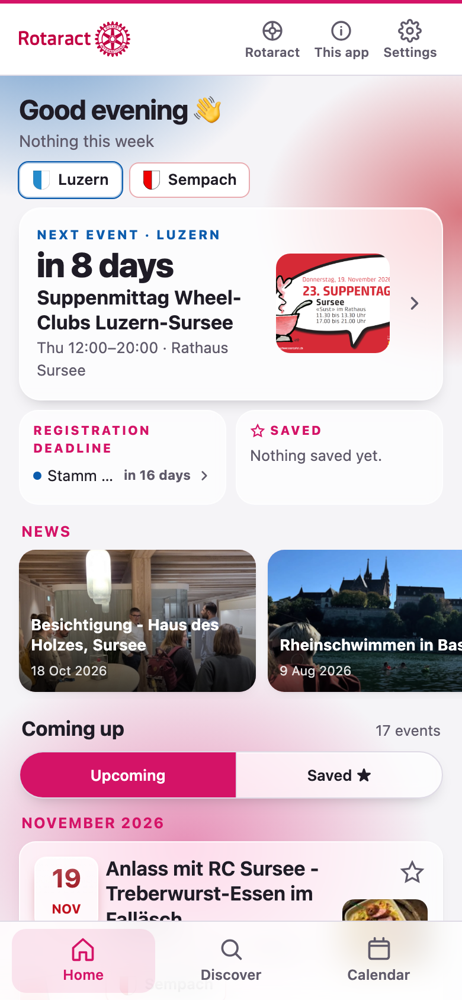
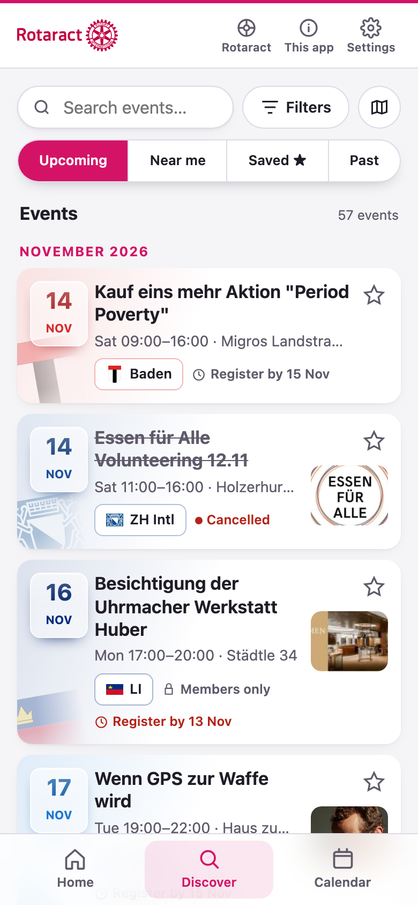
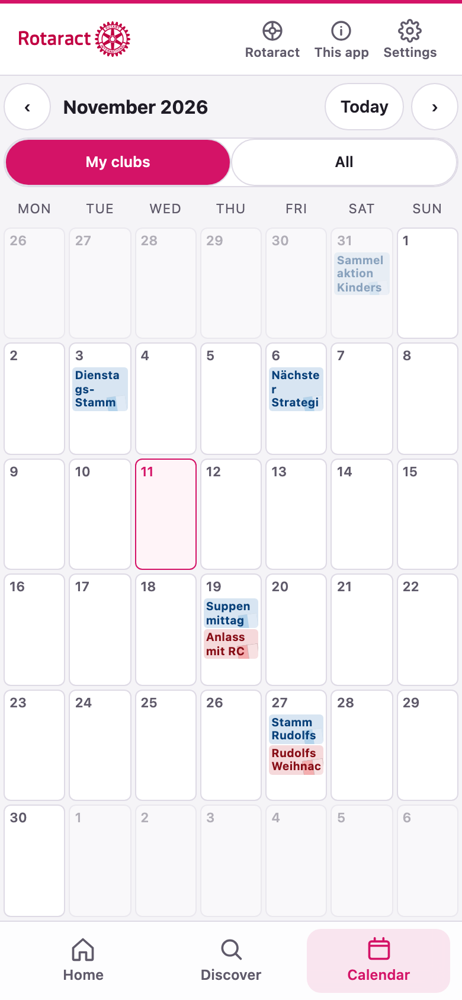
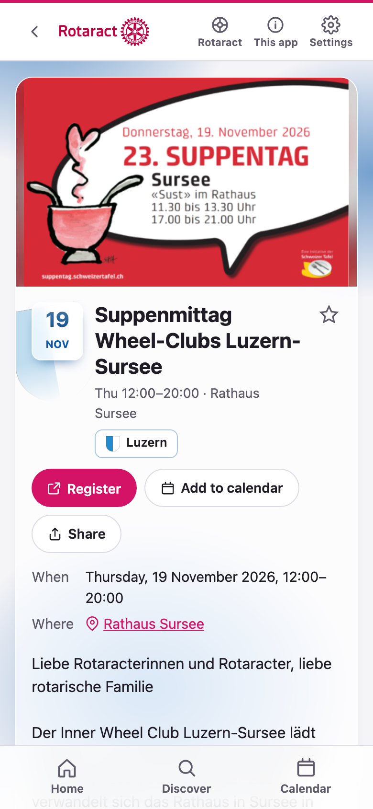

# Rotaract event aggregation tool

[](https://github.com/Neyxo/rotaract-events/actions/workflows/feeds.yml)
[](https://github.com/Neyxo/rotaract-events/releases)
[](LICENSE.md)
[](https://neyxo.github.io/rotaract-events/)

Collects the events of every Rotaract club in Switzerland & Liechtenstein from their Polaris sites and publishes them as an installable web app and as calendar feeds you can subscribe to.

**https://neyxo.github.io/rotaract-events/**

<p>
  
  
  
  
</p>

## What you get

- **The app**: Home (your clubs), Discover (everything, with filters and a map), a month calendar, a page per event and per club. German, French, Italian and English, light and dark, works offline with the last loaded events.
- **Calendar feeds**, refreshed every night:
  - one per club: `webcal://neyxo.github.io/rotaract-events/<club-id>.ics` (ids in `clubs.toml`)
  - all clubs: `webcal://neyxo.github.io/rotaract-events/all.ics`
- **Extra layers**: international events (REM, EUCO, the Convention), and Rotary clubs' shared events, which are off until switched on in Settings.

Members-only events appear with what the public agenda list shows and are marked "Members only"; details and registration stay on Polaris. Nothing about you leaves your device.

## Run locally

```bash
npm ci
npm test
npm run build                  # the web app, into dist/
python3 test_polaris_feed.py
python3 polaris_feed.py        # updates data/, writes feeds + site (dist/ included) to public/
python3 -m http.server -d public 8000
```

Then open http://localhost:8000. Node 24, Python 3.11+ (no Python dependencies). The app is React + TypeScript in `web/`, built with Vite. To work on the app, `npm ci` and `npm start` are enough: it serves the app with live reload, with the real data from `public/` if `polaris_feed.py` has run, otherwise with the test data.

The event history lives on the `data` branch; check it out once with `git worktree add data data`.

## Add or change a club

Edit its `[[clubs]]` entry in `clubs.toml`: Polaris website, language, city, crest and colour. Optional: `about` (one sentence), `how` (how to join), `partners`, `photos`, `instagram`. The fields are described at the top of that file.

## Hosting

GitHub Pages from GitHub Actions (Settings → Pages → Source: GitHub Actions), with read and write workflow permissions. `.github/workflows/feeds.yml` runs every night, on every push and by hand. Lint, typecheck and the tests run on a push or by hand; the nightly run only builds and syncs. A push that changes only the app doesn't read the clubs again: it takes the events from the last published site and deploys the new app with them (about 3 minutes instead of 9). A push that touches `polaris_feed.py` or `clubs.toml`, the nightly run and a run by hand read everything.

## Versions

[Semantic versioning](https://semver.org); the number is in `package.json` and shows in the app under Settings and on the developer screen. **Every push to main bumps it**: patch for fixes and text, minor for new features, major for breaking changes. The pre-push hook in `.githooks/` refuses a push without a new version (`npm install` turns it on), and the deploy workflow fails before publishing if one slips through.

```bash
npm version patch --no-git-tag-version   # or minor / major; then commit it with the change
git tag v0.10.0 && git push --tags       # optional: a tag becomes a GitHub release with generated notes
```

## More detail

- [The site](docs/site.md): the app, routes, languages, share pages, what is stored on the device
- [How events are tracked](docs/tracking.md): updates, cancellations, safety brake, locations
- [Layers](docs/layers.md): members-only events, international events, Rotary events, Instagram pictures
- [Design rules](docs/design.md): buttons, chips, status, cards, frosted glass

## Licence

[PolyForm Noncommercial 1.0.0](LICENSE.md): you may use, change and share the code for any noncommercial purpose, which includes personal projects, charities, schools and other clubs. Commercial use needs my permission; ask by opening an issue.

The licence covers the code. Club crests, the Rotaract and Rotary names and marks, and the event texts belong to their owners.

Contributions are welcome under the [Contributor Licence Agreement](CLA.md): you keep your copyright and give the maintainer the right to license your contribution, also under other terms. Opening a pull request means you agree to it.
